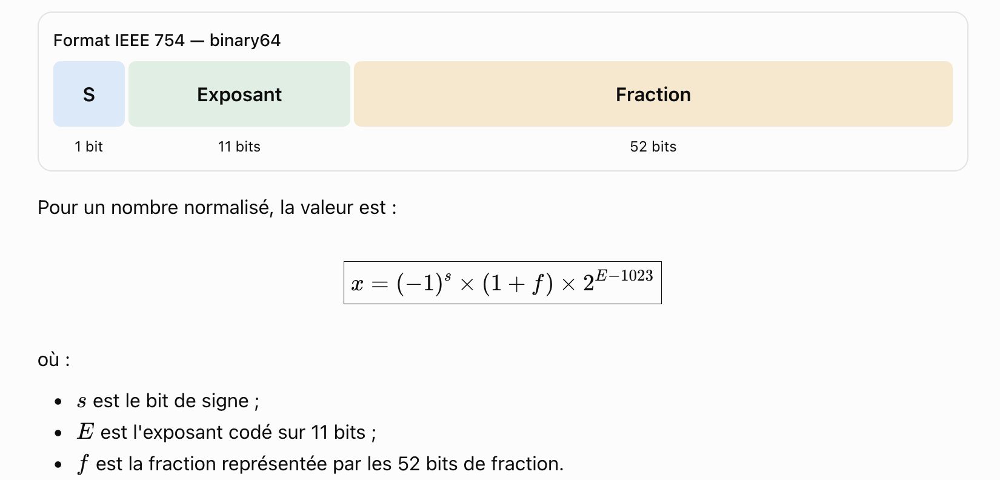
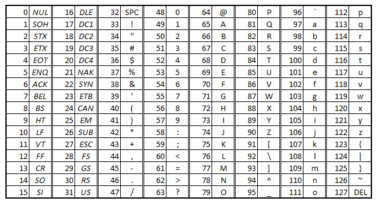

# Exercices : Représentation des données 

## Exercice 1 : Coder en binaire

1. Ecrire 52 sur un octet, c'est-à-dire sur 8 bits. Procéder à la main et vérifier dans la console.  
2. Calculer la somme 100110 + 001101 en posant l'addition. Traduire le calcul en décimal pour vérifier votre résultat. Vérifier dans la console en utilisant la notation en base 2 : 0b......

## Exercice 2 : Coder en hexadécimal

1. Déterminer à la main l'écriture hexadécimale du nombre dont l'écriture décimale est 172.
2. Donner l'écriture binaire du code hexadécimal B3.
3. Vérifier l'égalité des écritures en écrivant dans la console : 0x...... == 0b...... 

## Exercice 3 : Coder les conversions en python

Compléter les fonctions suivantes :

```Python
def conversion_decimal_binaire(n):
    """
    (1) Donne la représentation binaire du nombre entier décimal n
    param : n : int
    return : str
    >>> conversion_decimal_binaire(18)
    '10010'
    >>> conversion_decimal_binaire(141)
    '10001101'
    """
	pass        

def conversion_binaire_decimal(mot):
    """
    (2) Donne la valeur décimale d'un mot binaire
    param : n : int
    return : str
    >>> conversion_binaire_decimal('110011')
    51
    >>> conversion_binaire_decimal('1010101')
    85
    """
	pass 

def conversion_decimal_hexadecimal(n):
    """
    (3) Donne la représentation hexadécimale d'un nombre décimal n
    param : n : int
    return : str
    >>> conversion_decimal_hexadecimal(18)
    '12'
    >>> conversion_decimal_hexadecimal(141)
    '8d'
    """
	pass 


def conversion_hexadecimal_decimal(mot):
    """
    (4) Donne la valeur décimale d'un mot hexadécimal
    param : mot : str
    return : int
    >>> conversion_hexadecimal_decimal('ae')
    174
    >>> conversion_hexadecimal_decimal('34a')
    842
    """
	pass 

def conversion_binaire_hexadecimal_v1(mot):#la première version consiste à utiliser les deux fonctions précédentes
    #on transforme le binaire en décimal puis on transforme le décimal en hexadécimal
    """
    (5) Donne la représentation hexadécimale d'un mot binaire
    param: str
    return : str
    >>> conversion_binaire_hexadecimal_v1('101101001')
    '169'
    >>> conversion_binaire_hexadecimal_v1('110111')
    '37'
    >>> conversion_binaire_hexadecimal_v1('11111101')
    'fd'
    """
	pass 

def conversion_binaire_hexadecimal_v2(mot):#cette deuxième version consiste à faire des groupements de 4 bits
    #à chaque groupement on associe un code hexadécimal
    """
    (5) Donne la représentation hexadécimale d'un mot binaire
    param: str
    return : str
    >>> conversion_binaire_hexadecimal_v2('101101001')
    '169'
    >>> conversion_binaire_hexadecimal_v2('110111')
    '37'
    >>> conversion_binaire_hexadecimal_v2('11111101')
    'fd'
    """
	pass

def conversion_hexadecimal_binaire(mot):#chaque caractere du code hexadecimal est transformé en un paquet de 4 bits avec ajouts de 0 si nécessaire
    """
    (6) Donne la représentation binaire d'un mot hexadécimal
    param: str
    return : str
    >>> conversion_hexadecimal_binaire('169')
    '000101101001'
    >>> conversion_hexadecimal_binaire('37')
    '00110111'
    >>> conversion_hexadecimal_binaire('fd')
    '11111101'
    """
    pass 
    

if __name__ == "__main__":
    import doctest
    doctest.testmod(verbose = True) 
```

**Indications:**

(1) Écrire l'algorithme de divisions euclidiennes successives par 2 aussi longtemps que le quotient est strictement positif ; on ne connaît pas d'avance le nombre de tour de boucle à effectuer mais on peut écrire une **boucle conditionnelle**  `while`.    

(2) Les bits du mot binaire sont à multiplier par les puissances de 2 croissantes de droite à gauche à partir de 0 ; on fera pour cela une **boucle non conditionnelle** `for` en passant en revue les caractères du mot binaire. Penser à transformer une chaîne de caractères formée de nombres en nombre avec `int()`.
  
```Python
>>> int('7')
7
```
(3) Réutiliser (1) en introduisant `liste_remplaçant=["a","b","c","d","e","f"]`.  

(4) Réutiliser (2) en introduisant `liste_remplaçant=["a","b","c","d","e","f"]` et utiliser liste_remplaçant.index() pour trouver l'indice de position du caractère dans cette liste ; il suffira d'ajouter 10 à l'indice de position pour trouver la valeur décimale du caractère s'il appartient à cette liste.

(5) Ajouter au préalable autant de 0 au début du mot que nécessaire pour qu'il puisse être découpé en parties de 4 bits ; convertir chaque partie de 4 bits (utiliser slice[ : ]) en décimal, puis chaque valeur décimale en hexadécimal. 

Pour rajouter des 0 à gauche du mot binaire afin que sa longueur soit un multiple de 4 si ce n'est pas le cas, et qu'il puisse être découpé en parties de 4 bits, on peut écrire :

```Python
if len(mot)%4>0:
    mot='0'*(4-len(mot)%4)+mot  
```
en effet `len(mot)%4` nous dit combien il reste de bits après avoir fait des découpes de 4.

Pour faire une découpe ou slice dans un mot, utiliser l'écriture `mot[a:b]` qui prend les caractères entre la position `a` comprise et la position `b` non comprise, par exemple:

```Python
>>> mot="001100"
>>> mot[2:4]
'11'
```

(6) Utiliser les deux fonctions précédentes `conversion_decimal_binaire` et `conversion_hexadecimal_decimal`


## Exercice 4 : Coder les nombres relatifs

1. Comment code-t-on le nombre -15 sur 5 bits ? Réaliser les deux méthodes et vérifier votre résultat final en réalisant l'addition binaire sur 5 bits : 15 + (-15).
2. Comment se code - 56 sur le nombre de bit nécessaire à sa représentation ?

## Exercice 5 : Coder les nombres à virgule

En proposant deux méthodes :  
- une méthode utilisant la décomposition en puissances négatives de 2.  
- une méthode utilisant le décalage à gauche suite à la multiplication par 2

1. Écrire le nombre 3,625 en binaire.
2. Écrire le nombre 2,6875 en binaire.

## Exercice 6 : Coder les nombres à virgule selon la norme IEEE 754

Les flottants sont codés suivant la norme IEEE 754 sur 64 bits, soit 1 bit pour le signe, 11 bits pour l'exposant décalé et 52 bits pour la mantisse tronquée.



1. Comment est codé le nombre - 4.5 ?  
2. Quel est le nombre réel codé par 1011 1111 1110 1000 0000 ... 0000 ?

Pour vérifier, utiliser le [convertisseur](https://www.binaryconvert.com/result_double.html?decimal=050048), ou dans la console de Thonny :

```python
import struct

x = 3.5

bits = struct.unpack('>Q', struct.pack('>d', x))[0]

print(format(bits, '064b'))
```


## Exercice 7 : Une application pratique catastrophique du codage des nombres à virgule

🛰️ Contexte historique :

	•	Conflit : Guerre du Golfe (janvier–février 1991)

	•	Belligérants principaux :	Irak de Saddam Hussein, Coalition internationale menée par les États-Unis

	•	L’Irak tirait des missiles Scud (des missiles balistiques modifiés) contre Israël (pour provoquer une riposte israélienne), et sur l’Arabie saoudite où se trouvaient les troupes américaines.

🎯 Le rôle du Patriot

	•	Les missiles Patriot étaient des missiles antimissiles américains,leur but : intercepter les Scud irakiens en plein vol, le Patriot n’était donc pas offensif, mais défensif : il essayait de protéger les bases et les villes alliées contre les tirs irakiens.


💥 L’incident de Dhahran en Arabie saoudite (25 février 1991)

	•	Un Scud irakien est lancé vers Dhahran, une batterie Patriot américaine doit l’intercepter, mais à cause de l’erreur d’horloge accumulée (≈ 0,34 s après ~100 h de fonctionnement), le radar du Patriot calculait mal la position du Scud.

	•	Résultat : l’interception a échoué, le missile irakien a frappé une caserne américaine, tuant 28 soldats et en blessant plus de 90.

Les Patriot disposaient d'une horloge interne émettant un signal tous les 0.1 seconde. Le temps écoulé était obtenu en multipliant 0.1 par le nombre de signaux d'horloge reçus.

Ces systèmes Patriot américains étaient déployés depuis plusieurs jours, fonctionnant en continu.
Leur horloge interne n’était jamais réinitialisée entre les opérations, donc l’erreur de temps due à la mauvaise représentation de 0,1 s s’accumulait.

Le microcontroleur de l'antimissile *patriot* stocke la valeur 1/10 en ne conservant que 23 bits pour la partie décimale (codage en virgule fixe).

On observe que :

```Python
0.1=1.6*0.0625 soit :  
0.1=1.6*2^(-4) ou :  
0.1=1*2^(-4)+(0.5+0.1)*2^(-4) ou :  
0.1=1*2^(-4)+(2^(-1)+0.1)*2^(-4) ou :  
0.1=1*2^(-4)+2^(-5)+0.1*2^(-4) ou :  
en remplaçant le 0.1 du membre de droite par l'expression trouvée :

0.1=1*2^(-4)+2^(-5)+[1*2^(-4)+2^(-5)+0.1*2^(-4)]*2^(-4)

soit : 

0.1=1*2^(-4)+1*2^(-5)+1*2^(-8)+1*2^(-9)+0.1*2^(-8)

```
et on peut recommencer, on a affaire à une **écriture infinie et périodique**.

Ainsi: 0.1<sub>10</sub>=0.000110011001100110011001100110...<sub>2</sub>

1. Quelle est, en base 10, la valeur exacte qui est effectivement codée sur 23 bits à la place de 1/10 ?
3. Quelle est l'erreur approximative commise sur la représentation de 1/10 ?
4. En tenant compte de cette erreur, montrer que le décalage d'horloge du *patriot* par rapport à l'heure locale au bout de 100 h de fonctionnement sans réinitialisation est de 0.34 s.
5. Sachant que le missile se déplace à une vitesse d'environ 1676 m.s<sup>-1</sup>, à quelle erreur de position en mètre correspond le décalage d'horloge après 100h de fonctionnement.
6. Conclure, sachant que pour atteindre sa cible, un *patriot* doit l'approcher à moins de 500 m.


## Exercice 8 : Une application pratique catastrophique du codage des nombres relatifs
L’échec du vol Ariane 5(1996)

⸻

🚀 Contexte historique

Le 4 juin 1996, la fusée Ariane 5 décolle de Kourou (Guyane).
Après seulement 37 secondes de vol, elle dévie de sa trajectoire et s’autodétruit.
Perte : plus de 370 millions $.

L’enquête révèle que l’erreur provenait du logiciel de guidage inertiel, réutilisé depuis Ariane 4.
Ce logiciel convertissait une variable en virgule flottante (64 bits) en un entier signé (16 bits).
Mais la nouvelle fusée était plus rapide, et la valeur à convertir a dépassé ce que le format entier pouvait stocker.

⸻

🧮 Étape 1 – Comprendre le dépassement

L’unité de guidage calculait la vitesse horizontale sous forme d’un nombre réel (64 bits).
Cette valeur devait être convertie en entier signé 16 bits pour un autre module.

1️⃣ Question :

Quel est le domaine de valeurs possibles pour un entier signé codé sur 16 bits ?


🔢 Étape 2 – La valeur fautive

Lors du vol, la vitesse horizontale atteignait à un moment donné environ v = 32768.5 m/s par exemple.

2️⃣ Question :

Explique pourquoi la conversion vers un entier 16 bits a provoqué une erreur (overflow).
Que se passe-t-il lors de ce type de dépassement ?


## Exercice 9 : Les opérations entre booléens

1. Vérifier, à l'aide d'une table de vérités, l'égalité suivante entre expressions booléennes : 

`a xor b = (a and not(b)) or (not(a) and b)`.

Rappel : XOR is a binary operation, it stands for "exclusive or", that is to say the resulting bit evaluates to one if **only exactly one** of the bits is set to 1.

This is its function table:

a | b | a xor b
--|---|------
0 | 0 | 0
0 | 1 | 1
1 | 0 | 1
1 | 1 | 0


2. Comparer les résultats renvoyés par les trois fonctions suivantes, où x et y sont de type quelconque, sans les programmer en machine :
```python
def compare1(x,y):
    if x and y :
        return True
    else:
        return False
    
def compare2(x,y):
    return x and y

def compare3(x,y):
    return not(not x or not y)
```

## Exercice 10 : Le codage des caractères : codage et encodage en python

L'ASCII définit 128 caractères numérotés de 0 à 127 et codés en binaire de 0000000 à 1111111. Sept bits suffisent donc. Toutefois, les ordinateurs travaillant presque tous sur un multiple de huit bits (un octet) depuis les années 1970, chaque caractère d'un texte en ASCII est souvent stocké dans un octet dont le 8e bit est 0.

 

Pour obtenir le code ASCII d'un caractère :

```Python
>>> ord("k")
107
```

Écrire au préalable la fonction `conversion_decimal_binaire_complet` qui retourne un octet à partir d'une valeur décimale. Par rapport à la fonction `conversion_decimal_binaire` elle rajoute des 0 devant si nécessaire pour obtenir un octet.

```Python
def conversion_decimal_binaire_complet(n):
    """
    Donne la représentation binaire du nombre entier décimal n
    param : n : int
    return : str
    >>> conversion_decimal_binaire_complet(18)
    '00010010'
    >>> conversion_decimal_binaire_complet(141)
    '10001101'
    """
```

Compléter maintenant la fonction ci-dessous : 

```Python
def encodage_texte_ascII_binaire(texte):
    """
    Code un texte ascII en binaire
    param : texte : str
    return : str
    >>> encodage_texte_ascII_binaire("vive la nsi !")
    '01110110011010010111011001100101001000000110110001100001001000000110111001110011011010010010000000100001'
    """
```

Compléter maintenant la fonction ci-dessous qui permet de décoder le code binaire représentatif d'un texte.

Pour obtenir le caractère correspondant à un code décimal, utiliser 

```Python
>>> chr(52)
'4'
```

```Python
def decodage_binaire_texte_ascII(code_binaire):
    """
    Décode Code un texte ascII en binaire
    param : texte : str
    return : str
    >>> decodage_binaire_texte_ascII('01110110011010010111011001100101001000000110110001100001001000000110111001110011011010010010000000100001')
    'vive la nsi !'
    """
```


## Exercice 11 : Une application de l'opérateur booléen & : le masque

Les couleurs [(voir la simulation en JavaScript)](http://vfsilesieux.free.fr/colours.html) sont souvent exprimées en code hexadécimal selon le format RVB.   
Par exemple la couleur verte pomme peut être codée par #C7E180 ; les codes C7, E1 et 80 représentent respectivement les valeurs hexadécimales des niveaux de rouge, de vert et de bleu.  
L'écriture binaire en 3 octets (1 octet pour chacune des couleurs primaires dans la synthèse additive des couleurs) est aussi possible :
11000111 11100001 10000000 ; ce qui correspond aux niveaux : 199, 225, 128.

Montrer que l'on peut utiliser le masque 0xFF ou 0b11111111 pour extraire le niveau de bleu selon :

```python
>>> code=0xC7E180
>>> mask=0xFF
>>> mask==0b11111111
True
>>> hex(code & mask)
'0x80'
```
Montrer que l'on peut extraire le niveau de vert selon :

```python
>>> code=0xC7E180
>>> mask=0xFF<<8#<<8 pour décaler de 8 bits vers la gauche
>>> mask==0b1111111100000000
True
>>> hex((code & mask)>>8)#>>8 pour décaler de 8 bits vers la droite
'0xe1'
```

Montrer comment extraire le niveau de rouge avec ce masque.

